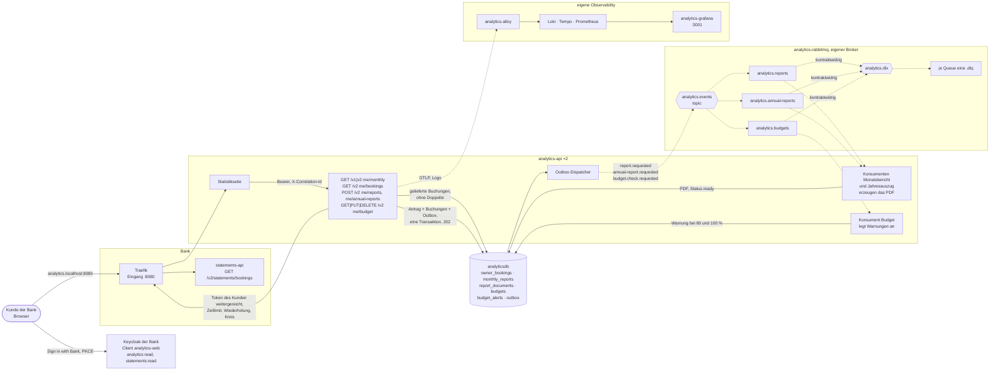

# analytics-api

Der Dienst der **Analytics-Firma** im Modul M321. Ein externer Partner der Bank: er liest die
Buchungen eines Kunden über HTTP beim Auszugsdienst der Bank, mit dem Token dieses Kunden aus
"Sign in with Bank" und nur mit seiner Zustimmung, rechnet daraus Summen und zeigt sie ihm. Code,
Datenbank und Broker der Bank sieht er nicht. Kontrakte und Deployment des Gesamtsystems liegen im
Shared-Repo `Tim-Fischer-zh/m321-main`.



Durchgezogene Pfeile sind synchrone Aufrufe, gestrichelte Nachrichten über den eigenen Broker und
die Daten für die eigene Observability. Traefik ist der gemeinsame Eingang: über ihn kommt der Kunde
zur Statistikseite, und über ihn fragt der Dienst die Bank.

| Fall | Was passiert |
|---|---|
| Kunde ruft seine Summen oder Buchungen ab | der Dienst fragt `GET /v2/statements/bookings` mit dem Token des Kunden, aus dem erzeugten Client von `contracts/statements/openapi.v2.yaml`; Antwort mit `X-Data-Source: live` |
| Token ohne `statements:read` oder Bank lehnt ab (401, 403) | 403 mit `WWW-Authenticate: Bearer error="insufficient_scope", scope="statements:read"`; alles, was von diesem Kunden gespeichert war, wird gelöscht |
| Bank nicht erreichbar, Zeitlimit, 5xx, Kreis offen | der zuletzt gespeicherte Stand mit `X-Data-Source: stored`; ist nichts gespeichert, 503 mit `Retry-After` |
| kurzer Netzaussetzer | bis zu zwei Wiederholungen; nach fünf Fehlversuchen öffnet der Kreis für 15 s und die Bank wird nicht mehr gefragt |
| dieselbe Buchung kommt zweimal, auch von zwei Instanzen gleichzeitig | einmal gespeichert: `transactionId` ist Primärschlüssel, `INSERT ... ON CONFLICT DO NOTHING` |
| eigene Datenbank weg | Summen und Buchungen kommen trotzdem von der Bank; was nur in der eigenen Datenbank steht (Berichte), antwortet 503 mit `Retry-After` |
| kein oder ungültiges Token | 401 |
| Token ohne Scope `analytics:read` | 403 mit `scope="analytics:read"` |
| `system/daily` ohne Rolle `bank-admin` | 403; mit Rolle die Tagessummen über die Kunden, deren Buchungen mit Zustimmung gespeichert sind |
| fremde Summen oder Buchungen | gibt es nicht: der Inhaber kommt aus `sub` im Token, und die Bank liefert nur seine Buchungen |
| Monatsbericht beantragt | Buchungen des Monats von der Bank holen, mit Antrag und Outbox-Eintrag in einer Transaktion speichern, sofort **202**; das PDF entsteht über den eigenen Broker. Ein Token geht nie in eine Queue |
| Bank weg, während ein Bericht beantragt wird | 503, kein halber Antrag bleibt liegen |
| eigener Broker weg | der Antrag liegt in der Outbox und geht hinaus, sobald der Broker zurück ist |
| derselbe Antrag kommt doppelt, auch auf beiden Instanzen gleichzeitig | ein PDF: der zweite Konsument merkt an `xmin` von Postgres, dass der Bericht schon fertig ist |
| Jahresauszug beantragt (`POST /v2/analytics/me/annual-reports`) | wie der Monatsbericht, aber die Buchungen des ganzen Jahres und die eigene Queue `analytics.annual-reports`; PDF "Jahresauszug 2025" |
| Budget festgelegt (`PUT /v2/analytics/me/budget`) | gilt für jeden Monat; der laufende Monat wird gleich im Hintergrund geprüft |
| neue Buchungen von der Bank gespeichert, Kunde hat ein Budget | Prüfung über `analytics.budgets`; ab 80 % eine Warnung, ab 100 % eine zweite, jede einmal im Monat, auch bei zwei Instanzen. Die Seite zeigt sie oben auf jeder Seite |
| Nachricht passt nicht zum Kontrakt | ohne Wiederholung in die DLQ ihrer Queue, z. B. `analytics.reports.dlq` |

## Starten

```bash
docker compose up --build -d                              # Dienst, Postgres, eigener RabbitMQ
docker compose --profile observability up --build -d      # dazu der eigene Observability-Stack
docker compose up -d --scale analytics-api=3              # drei Instanzen
```

Allein gestartet fragt der Dienst die Bank unter `http://host.docker.internal:8080`, also das
Gesamtsystem auf demselben Rechner. Läuft es nicht, startet der Dienst trotzdem und zeigt
gespeicherte Buchungen oder antwortet 503.

Das Profil `observability` ist der eigene Stack der Analytics-Firma: Alloy, Loki, Tempo,
Prometheus und Grafana, Konfiguration in [observability](observability), Grafana auf
http://127.0.0.1:3001 mit den Dashboards "Analytics: Logs", "Analytics: Metriken" und "Analytics:
Traces", aufgebaut wie die der Bank. Derselbe Stack läuft im
Gesamtsystem. Das Gesamtsystem mit den Diensten der Bank startet aus `m321-main`, mit einem lokal
gebauten Image so:

```bash
docker build -f src/Analytics.Api/Dockerfile -t ghcr.io/leart165/analytics-api:local .
cd ../m321-main && ANALYTICS_TAG=local docker compose --profile observability up -d

# mit der Seite zusätzlich auf localhost:8091, solange analytics.localhost nicht freigeschaltet ist
ANALYTICS_TAG=local docker compose -f docker-compose.yml -f ../override-port-8091.yml --profile observability up -d
```

`../override-port-8091.yml` liegt neben den Repositories, in keinem davon. Sie gibt Traefik
einen zweiten Eingang `:8091` (dafür steht dort Tims ganze `command`-Liste von Traefik, ergänzt um
`--entrypoints.analytics.address=:8091`) und `analytics-api` einen Router darauf:

```yaml
  analytics-api:
    labels:
      traefik.http.routers.analytics-local.rule: "PathPrefix(`/`)"
      traefik.http.routers.analytics-local.entrypoints: analytics
      traefik.http.routers.analytics-local.middlewares: analytics-limit
      traefik.http.routers.analytics-local.service: analytics
```

Sobald Tim `http://analytics.localhost:8080/*` bei `analytics-web` einträgt, fällt die Datei weg.

| Adresse im Gesamtsystem | Was |
|---|---|
| http://analytics.localhost:8080/ | Statistikseite, "Sign in with Bank"; die Anmeldung geht hier erst, wenn Tim die Adresse bei `analytics-web` freischaltet |
| http://localhost:8091/ | dieselbe Seite über einen zweiten Eingang von Traefik, mit Login, beiden Instanzen und Ratenlimit; diese Rücksprung-Adresse kennt Keycloak schon. Dafür mit der Zusatzdatei starten, siehe unten |
| http://localhost:8080/v1/analytics/..., `/v2/analytics/...` | API über Traefik |
| http://localhost:8080/analytics/swagger/index.html | Spezifikation mit Scopes |
| http://localhost:8080/analytics/health | Bereitschaft mit Datenbankprüfung; die Bank gehört nicht dazu |
| http://127.0.0.1:15674 | der eigene RabbitMQ `analytics-rabbitmq`, guest / guest |
| http://127.0.0.1:3001 | das eigene Grafana, admin / admin: Logs, Traces und Metriken nur der Analytics-Firma |
| http://127.0.0.1:3000 | das Grafana der Bank; Logs der Analytics-Firma sammelt es nicht |

## Tests

```bash
docker compose up -d analyticsdb analytics-rabbitmq
dotnet test
node --test "tests/frontend/*.test.mjs"
```

Die Bank spielt in den Tests `FakeStatementsApi`: sie liefert jedem Kunden nur seine Buchungen,
merkt sich jeden Aufruf mit Token und Korrelations-Id und kann ablehnen, ausfallen oder hängen.

Mehr in [docs/architecture.md](docs/architecture.md), die Vorführung in [docs/demo.md](docs/demo.md),
Bildschirmfotos aus dem Gesamtsystem in [docs/nachweis](docs/nachweis).
