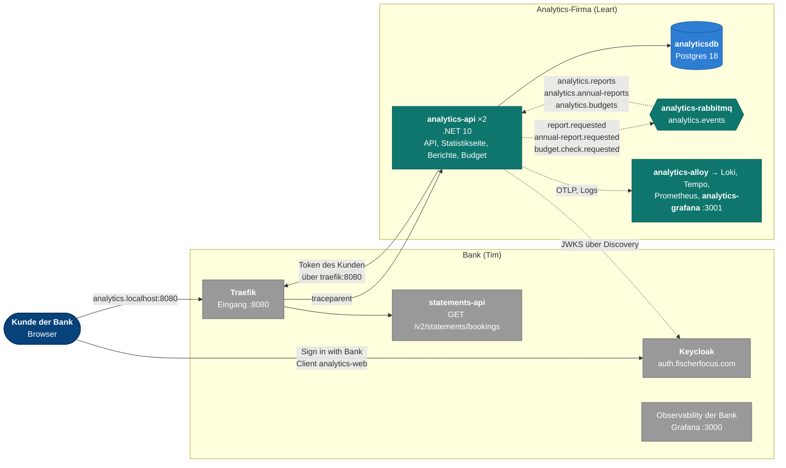
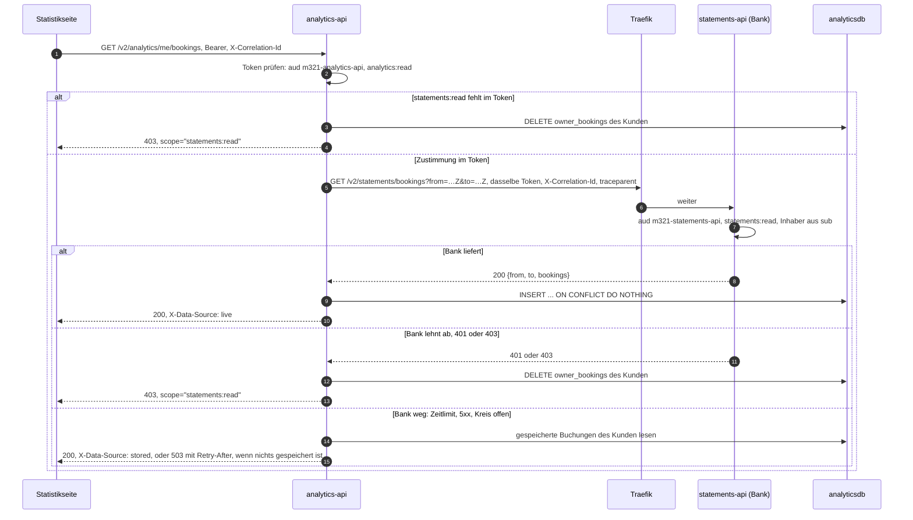
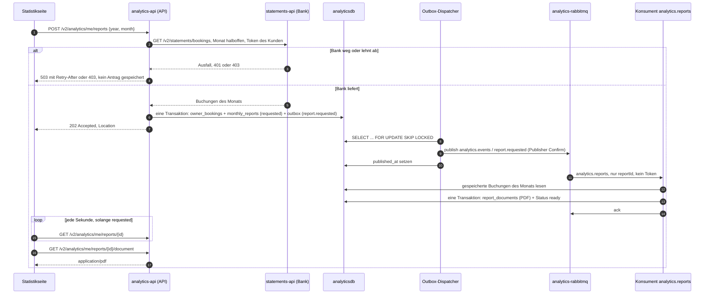
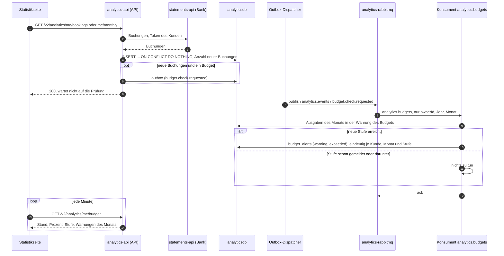
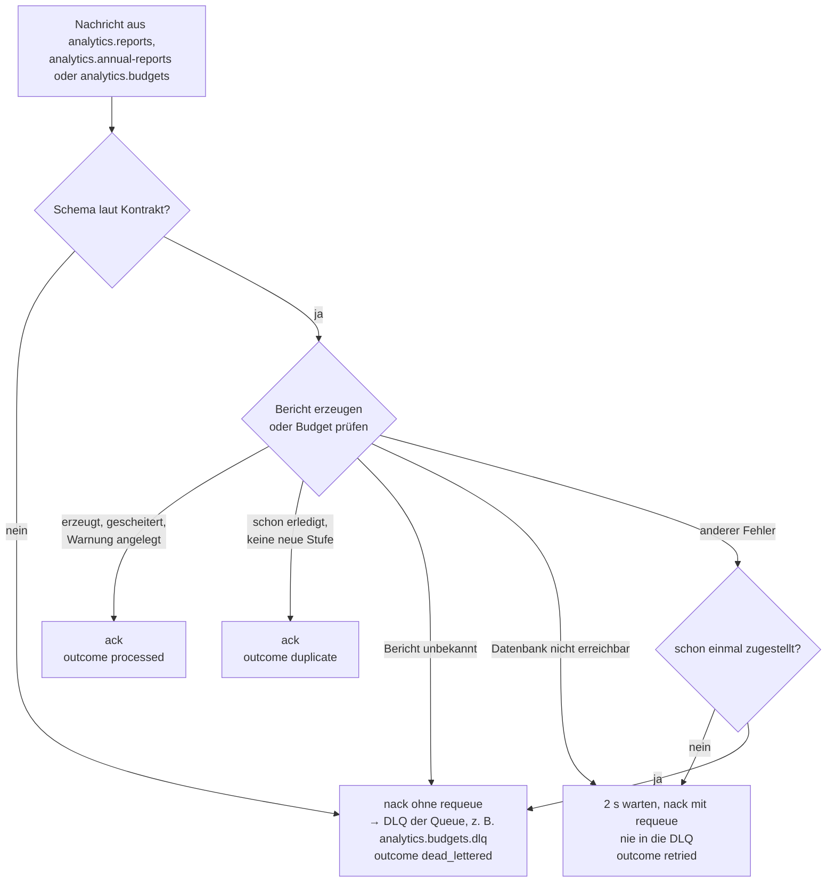
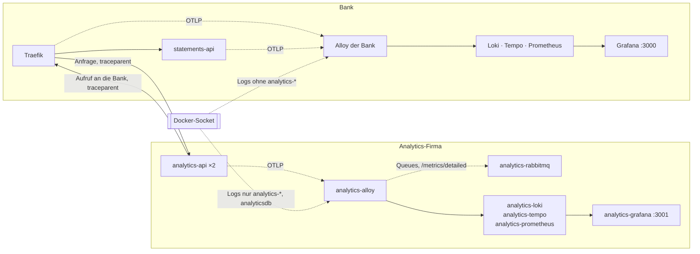

# Architektur

Ich baue in diesem Repository den Auswertungsdienst für das Modul M321. In unserem Team ist Tim
die Bank; ich spiele eine **externe Analytics-Firma**, die für die Kunden der Bank Statistiken
rechnet. Ich sehe weder Code noch Datenbank noch Broker der Bank, sondern nur, was sie über
veröffentlichte Kontrakte anbietet: die Buchungen eines Kunden über HTTP und Tokens aus ihrem
Keycloak (`auth.fischerfocus.com`, Realm `personal`) für Kunden, die mich bei "Sign in with Bank"
zugelassen haben.

Kontrakte und Deployment des Gesamtsystems liegen im Shared-Repo `Tim-Fischer-zh/m321-main`.
Dieses Dokument beschreibt, was heute in diesem Repository steht.

## Überblick



Durchgezogen ist synchron (HTTP), gestrichelt asynchron. Mein Container hängt nur im Netz
`partner`: er sieht `analyticsdb`, `analytics-rabbitmq`, `analytics-alloy` und `traefik`, aber
weder eine Datenbank noch den Broker noch die Observability der Bank.

| Richtung | Protokoll | Kontrakt | Zweck |
|---|---|---|---|
| Analytics → Bank | HTTP über Traefik, Token des Kunden | `statements/openapi.v2.yaml` (ab 2.1.0), `auth/scopes.md` | die Buchungen eines Kunden, ohne Konto und Buchungstext |
| Kunde → Analytics | HTTP über Traefik | `analytics/openapi.v1.yaml`, `.v2.yaml`, `auth/scopes.md` | Summen, Buchungen, Berichte, Budget |
| Analytics → Keycloak | HTTPS, Discovery und JWKS | `auth/jwt.md` | Token prüfen |
| Analytics → Analytics | AMQP am eigenen Broker | `analytics/events.asyncapi.v1.yaml` | Monatsbericht und Jahresauszug erzeugen, Budget prüfen, im Hintergrund |

## Aufbau des Codes (DDD, Schichten nach innen)

```
src/
  Analytics.Domain/          Buchung, Währung, Beitrag zu den Summen; Bericht (Aggregat mit Zustand),
                             Berichtszeitraum Monat oder Jahr, Inhalt des Berichts (MonthlyStatement);
                             Monatsbudget und Budgetwarnung
  Analytics.Application/     CustomerLedger (Buchungen bei der Bank, gespeicherter Stand,
                             Zustimmung), LedgerTotals (Summen je Monat und Tag), ReportService,
                             BudgetService; Ports IBankBookings, IBookingStore, I*Reader,
                             IMonthlyReportRepository, IBudgetRepository, IReportEvents,
                             IBudgetEvents, IStatementRenderer, IUnitOfWork
  Analytics.Infrastructure/  Bank: aus dem Kontrakt erzeugter Client, Zeitlimit, Wiederholung,
                             Circuit Breaker; Postgres (EF Core), Outbox und Dispatcher, RabbitMQ
                             (eigener Broker), PDF ohne fremde Bibliothek, OpenTelemetry
  Analytics.Api/             Controller, DTOs, Keycloak-Prüfung mit Scopes, Weitergabe des Tokens an
                             die Bank, Readiness, Swagger, Statistikseite unter wwwroot → Container
tests/Analytics.Tests/       Domäne, Persistenz, nachgebildete Bank, Broker, API, Kontrakte, Observability
tests/frontend/              JavaScript der Statistikseite
contracts/                   Kopie aus m321-main, dazu der eigene events.asyncapi.v1.yaml
```

Die Abhängigkeiten zeigen nur nach innen. `Analytics.Domain` kennt nichts, nicht einmal JSON.
`CustomerLedger` weiss nicht, dass die Bank über HTTP gefragt wird; das weiss nur der Adapter
`StatementsBookings`. Es gibt keinen geteilten Code mit der Bank: Client, Resilience, Scopes und
Readiness folgen denselben Regeln wie bei Tim, sind hier aber eigenständig umgesetzt.

## Synchron: die Buchungen eines Kunden bei der Bank lesen



| Baustein | Wo | Warum |
|---|---|---|
| `StatementsApiClient` | Infrastructure, bei jedem Build mit NSwag aus `contracts/statements/openapi.v2.yaml` erzeugt | Ändert die Bank den Kontrakt, kompiliert der Dienst nicht mehr, statt zur Laufzeit ins Leere zu greifen. Zeitpunkte mit Zeitzone (`/ParameterDateTimeFormat:o`), wie der Kontrakt es verlangt |
| `ForwardHeadersHandler` | Api | Reicht `Authorization` und `X-Correlation-Id` der laufenden Anfrage weiter. Die Analytics-Firma handelt nie im eigenen Namen und hat kein eigenes Geheimnis |
| `BankResilience` | Infrastructure | Zeitlimit 5 s gesamt, 2 s je Versuch, zwei Wiederholungen nur bei vorübergehenden Fehlern, Circuit Breaker: öffnet nach fünf Fehlversuchen für 15 s. 401 und 403 öffnen ihn nie, sonst könnte ein Kunde ohne Zustimmung die Bank für alle abschalten |
| `CustomerLedger` | Application | Zustimmung, gespeicherter Stand, Löschen bei Absage |
| `BankFailureHandler` | Api | Absage der Bank: 403 `insufficient_scope`, `scope="statements:read"`; Ausfall ohne gespeicherten Stand: 503 mit `Retry-After` |

**Zeitraum.** Die Bank rechnet halboffen in UTC. Ein Tag bis `to` heisst `from = from 00:00Z`
bis `to + 1 Tag 00:00Z`; ein Jahr für `me/monthly` heisst 1. Januar bis 1. Januar des Folgejahres;
ein Monat für den Bericht erster Tag bis erster Tag des nächsten.

**Zustimmung.** `statements:read` schreibt Keycloak nur nach der Zustimmung des Kunden ins Token.
Fehlt der Scope, fragt der Dienst die Bank gar nicht. Fehlt er oder lehnt die Bank ab, löscht der
Dienst alles, was er von diesem Kunden gespeichert hat. So sieht die Analytics-Firma nur Kunden,
die zugestimmt haben, und nur, solange sie zustimmen.

**Gespeicherter Stand.** Was die Bank liefert, landet in `owner_bookings`, mit der `transactionId`
als Primärschlüssel: dieselbe Buchung zweimal, auch aus zwei Instanzen gleichzeitig, steht einmal
da. Ist die Bank nicht erreichbar und von diesem Kunden etwas gespeichert, kommt dieser Stand mit
`X-Data-Source: stored`, und die Seite zeigt "Bank nicht erreichbar, gespeicherter Stand". Ist
die eigene Datenbank weg, kommen die Zahlen trotzdem von der Bank; nur das Speichern fällt aus.

**Entkopplung.** Die Bank weiss nichts von der Analytics-Firma ausser dem Client `analytics-web`
in ihrem Keycloak und dem Eintrag im Log ihres Auszugsdienstes. Fällt die Bank aus, zeigt der
Dienst den gespeicherten Stand, erzeugt bereits beantragte Berichte weiter und bleibt bereit.

## Asynchron: ein Monatsbericht als PDF

Gebaut wie die Überweisung der Bank: annehmen, sofort antworten, im Hintergrund erledigen. Die
Nachricht geht über einen **eigenen Topic-Exchange** `analytics.events` am **eigenen Broker**
`analytics-rabbitmq`, so wie die Bank ihre Ereignisse über `bank.events` schickt. Kontrakt:
`contracts/analytics/events.asyncapi.v1.yaml`.



Das Token des Kunden braucht nur die API, beim Antrag. In die Queue kommt nur die `reportId`: ein
Token gehört nie in eine Nachricht. Ist die Bank beim Antrag nicht erreichbar, gibt es keinen
Antrag und 503; ein Bericht zeigt den ganzen Monat, nicht einen gespeicherten Teil.

| Baustein | Wo | Warum |
|---|---|---|
| Aggregat `MonthlyReport`, Zustände `Requested → Ready \| Failed` | Domain | Ein abgeschlossener Bericht ändert sich nie wieder, wie der Überweisungsauftrag der Bank |
| `MonthlyStatement` | Domain | Was im Bericht steht (Reihenfolge, Summen je Währung), unabhängig vom PDF |
| `ReportService` | Application | `RequestAsync` in der API, `GenerateAsync` im Konsumenten |
| Outbox | Infrastructure | Antrag, Buchungen und Ereignis werden zusammen gültig; steht der Broker, geht nichts verloren |
| `xmin` als Concurrency-Token | Infrastructure | Bekommen zwei Instanzen denselben Antrag, gewinnt die erste, die zweite bestätigt nur |
| PDF aus Standardschriften, schwarz-weiss | Infrastructure | Keine Schriftdateien und keine native Bibliothek im alpine-Image |

## Asynchron: Jahresauszug

Derselbe Weg wie beim Monatsbericht, mit eigenem Routing Key `annual-report.requested` und eigener
Queue `analytics.annual-reports` (DLQ `analytics.annual-reports.dlq`). Der Antrag holt die
Buchungen des ganzen Jahres bei der Bank, 1. Januar bis 1. Januar des Folgejahres, halboffen.
Das laufende Jahr geht, ein künftiges nicht. Der Jahresauszug ist ein Bericht mit Zeitraum Jahr
(`monthly_reports.month` ist leer); Liste, Status und PDF laufen über dieselben Endpunkte. Das
PDF heisst `jahresauszug-2025.pdf` und trägt im Titel "Jahresauszug 2025".

Eine eigene Queue, weil ein Jahr viel mehr Buchungen hat als ein Monat: ein langer Jahresauszug
hält keinen Monatsbericht auf, und beide lassen sich getrennt beobachten und skalieren.

## Asynchron: Budget und Warnung

Der Kunde legt ein Budget für seine Ausgaben im Monat fest (`PUT /v2/analytics/me/budget`).
Ausgaben sind wie bei den Summen Auszahlungen und ausgehende Überweisungen. Erreichen sie 80
Prozent, gibt es eine Warnung, bei 100 Prozent eine zweite. Die Seite zeigt sie oben auf jeder
Seite und auf der Karte "Monatsbudget".



| Baustein | Wo | Warum |
|---|---|---|
| `MonthlyBudget`, `BudgetLevel`, `BudgetAlert` | Domain | Ein Budget je Kunde, über 0, höchstens 1 000 000, zwei Nachkommastellen; ab 80 Prozent `warning`, ab 100 `exceeded` |
| `BudgetService` | Application | `SetAsync` und `GetStatusAsync` in der API, `CheckAsync` im Konsumenten. Ohne Zustimmung (`statements:read`) kein Budget: 403 |
| Eindeutiger Index `ux_budget_alerts_owner_month_level` | Infrastructure | Jede Stufe einmal im Monat, auch wenn zwei Instanzen gleichzeitig prüfen oder eine Nachricht doppelt kommt |
| Prüfung nur bei neuen Buchungen | Api | Jeder Abruf liefert dieselben Buchungen wieder; eine Prüfung braucht es nur, wenn wirklich etwas Neues gespeichert wurde, und beim Ändern des Budgets |

Gerechnet wird mit den gespeicherten Buchungen: sie kommen von der Bank, mit Zustimmung. Zieht
der Kunde sie zurück, löscht der Dienst mit den Buchungen auch seine Warnungen; das Budget bleibt,
zeigt aber nichts, bis er wieder zustimmt.

## Fehlerbehandlung beim Konsumieren



Der Dead-Letter-Exchange ist `analytics.dlx` (direct), der Routing Key ist der Name der Queue.
Jede der drei Queues hat ihre eigene DLQ.
Ist der Broker beim Start nicht da oder scheitert die Vorbereitung, wird der Kanal geschlossen
und alle zwei Sekunden neu versucht; es bleiben keine Kanäle liegen (getestet, indem dem Benutzer
die Rechte entzogen und wieder gegeben werden).

## Vom Broker der Bank zu HTTP

Die Buchungen kamen zuerst über den Broker der Bank: als internes `transaction.completed`
(Queue `analytics.ledger`, `analytics/asyncapi.v1.yaml`), dann als schlankes
`partner.transaction.completed` (Queue `analytics.partner`, `analytics/asyncapi.v2.yaml`) mit
einem eigenen, eingeschränkten Broker-Benutzer. Beide Umstellungen liefen als Expand and Contract.

Seit Ende Oktober trennen wir die Firmen ganz. Die Analytics-Firma hängt nicht mehr am Broker der
Bank, sondern liest mit dem Token des Kunden über HTTP. Gründe:

- Zwischen den Firmen gibt es jetzt einen **synchronen Aufruf über einen formalen
  OpenAPI-Kontrakt**; vorher hatte dieser Dienst keinen Aufruf von Dienst zu Dienst.
- Die Analytics-Firma sieht **nur Kunden, die zugestimmt haben**, und nur, solange sie zustimmen.
  Über den Broker bekam sie die Buchungen aller Kunden.
- Kein Zugang zu fremder Infrastruktur: kein Broker-Benutzer, kein Netz der Bank.

| Schritt | Wer | Was |
|---|---|---|
| Expand | Tim | `GET /v2/statements/bookings` in `statements/openapi.v2.yaml` 2.1.0, `statements:read` als optionaler Scope von `analytics-web` |
| Migrate | Leart | Client aus dem Kontrakt, Token weiterreichen, Resilience; Summen, Buchungen und Berichte aus der Antwort der Bank; eigener Broker; Konsument von `analytics.partner`, Deklaration an `bank.events` und Laufzeitprüfung gegen `partner/asyncapi.v1.yaml` entfernt; Tabellen `processed_transactions`, `owner_monthly`, `system_daily` per Migration gelöscht |
| Contract | Tim | `partner.transaction.completed` nicht mehr veröffentlichen, `broker-setup`, `partner-access.sh` und Benutzer `analytics` entfernen, Broker der Bank aus dem Netz `partner` nehmen |

Keine Firma muss gleichzeitig mit der anderen deployen: zwischen den Schritten laufen beide Wege.

`analytics/openapi.v1.yaml` bleibt unverändert, wie jeder veröffentlichte Kontrakt; die CI von
`m321-main` lehnt jede Änderung an einer `*.v1.yaml` ab. Version 1 antwortet weiter im selben
Format, liest aber ebenfalls bei der Bank: `me/monthly` kann deshalb neu 403 mit
`scope="statements:read"` und 503 liefern. Beschrieben ist das in `analytics/openapi.v2.yaml`.

## Security: Scope, Rolle, Besitz

Ein Zugriff braucht drei Dinge (`contracts/auth/scopes.md`):

| Frage | Hier |
|---|---|
| Was darf der **Client** im Namen des Kunden? | Scope `analytics:read` im Claim `scope`, Policy an allen Endpunkten. Fehlt er: 403 mit `scope="analytics:read"`. Für alles, was bei der Bank liest, zusätzlich `statements:read`; fehlt er oder lehnt die Bank ab: 403 mit `scope="statements:read"` |
| Was darf der **Benutzer**? | `system/daily` zusätzlich Realm-Rolle `bank-admin` aus `realm_access`. Fehlt sie: 403 ohne `insufficient_scope`, mehr Zustimmung hilft nicht |
| **Welche** Daten? | Der Inhaber kommt aus `sub`, nie aus der Anfrage; die Bank liefert ohnehin nur seine Buchungen |

Dazu die Prüfung des Tokens selbst: ES256 fest, `iss`, `aud` = `m321-analytics-api`, Ablauf,
`typ` = `Bearer`, `sub`, `iat`. Das Token trägt nach der Zustimmung beide Audiences; dieser
Dienst prüft nur seine, der Auszugsdienst nur seine. `statements:read` verlangt die Bank, nicht
dieser Dienst; die Spezifikation nennt an den Operationen deshalb nur `analytics:read` und
beschreibt `statements:read` in der Antwort Forbidden.

`system/daily` zeigt Tagessummen nur über die Kunden, deren Buchungen mit Zustimmung gespeichert
sind. Bankweite Zahlen gibt die Bank keinem fremden Client, auch nicht einem Mitarbeiter mit
`bank-admin`.

## Statistikseite, "Sign in with Bank"

HTML, CSS und JavaScript-Module ohne Framework unter `src/Analytics.Api/wwwroot`, ausgeliefert
vom Dienst selbst. Im Gesamtsystem unter **`http://analytics.localhost:8080/`**, über eine
Host-Regel in Traefik: eine eigene Origin, damit ein Skript dieser Seite nie an die Tokens des
Frontends der Bank unter `localhost:8080` kommt.

Anmeldung mit PKCE am Client `analytics-web`, Scopes `analytics:read statements:read`. Beim ersten
Mal fragt die Bank den Kunden um Zustimmung; entziehen kann er sie in der App der Bank unter
"Verbundene Dienste". Die Seite zeigt die Monatssummen, jede Buchung, Monatsberichte und
Jahresauszüge, das Monatsbudget mit Warnung oben auf jeder Seite, für
`bank-admin` die Tagessummen, welche Freigabe der Kunde erteilt hat, bei fehlender Zustimmung
einen Knopf für die neue, und in der Statusleiste, wenn die Bank nicht erreichbar war. Eine
Content-Security-Policy erlaubt nur eigene Skripte und Verbindungen zur API und zum Keycloak.

Im Keycloak braucht `analytics-web` dafür `http://analytics.localhost:8080/*` als Redirect-URI
und `http://analytics.localhost:8080` als Web Origin; das trägt Tim ein. Bis dahin kennt Keycloak
nur `http://localhost:8091/`. Eine Zusatzdatei für Compose gibt Traefik dafür einen zweiten
Eingang auf 8091 mit derselben Route zu beiden Instanzen, siehe README: Login, Lastverteilung,
Ratenlimit und der Ausfall einer Instanz gehen dort genauso.

## Observability

Die Analytics-Firma hat einen **eigenen Stack**, gleich aufgebaut wie der der Bank:
`analytics-alloy` sammelt, `analytics-loki`, `analytics-tempo` und `analytics-prometheus`
speichern, `analytics-grafana` zeigt, auf http://127.0.0.1:3001 mit drei Dashboards wie bei der Bank:
"Analytics: Logs", "Analytics: Metriken" (Anfragen der Kunden, Aufrufe bei der Bank, eigener
Broker, Resilienz, Laufzeit) und "Analytics: Traces" (wer ruft wen auf, Aufrufe bei der Bank,
Fehler, langsame Anfragen). Konfiguration in `observability/`, im Gesamtsystem als Kopie unter
`observability/analytics` in `m321-main`. Nur Alloy hängt im Netz `partner`, die Speicher und
Grafana im eigenen Netz `analytics-observability`.

Alloy liest Logs über den Docker-Socket, behält aber nur die eigenen Container (`analytics-*`,
`analyticsdb`). Der Alloy der Bank lässt genau diese weg. Jede Firma sieht nur ihre eigenen Logs,
Traces und Metriken.



Verbunden sind die beiden Seiten nur über Ids, die in den Aufrufen mitgehen: die Trace-Id im
`traceparent` und die Korrelations-Id. Wer einen Aufruf über die Firmengrenze verfolgen will,
sucht dieselbe Id in beiden Grafanas.

| Was | Umsetzung |
|---|---|
| Logs | JSON auf stdout mit Scopes und UTC; der eigene Alloy liest sie aus Docker ins eigene Loki. Jede Zeile einer Anfrage trägt `CorrelationId`, jede Zeile einer Nachricht zusätzlich `MessageId` und `Queue`, mit Tracing `TraceId` und `SpanId` |
| Korrelation | `X-Correlation-Id` kommt von der Seite, steht in jeder Logzeile, geht mit dem Aufruf an die Bank und mit jeder eigenen Nachricht im Kopf (`correlation-id` und AMQP `CorrelationId`); der Payload enthält nur, was der Kontrakt erlaubt |
| Traces | OpenTelemetry über OTLP an den eigenen Alloy, weiter ins eigene Tempo, Dienstname `analytics-api`. HTTP setzt den Trace von Traefik fort; der Aufruf an die Bank trägt `traceparent`, der Auszugsdienst setzt ihn fort; `report.requested` trägt ihn bis zum PDF. Ein Trace über beide Firmen hat damit eine Trace-Id, aber zwei Hälften: die Spannen von Traefik und Auszugsdienst liegen im Tempo der Bank, die eigenen im eigenen. Im eigenen Tempo fehlt deshalb bei Anfragen über Traefik die erste Spanne ("root span not yet received") |
| Metriken | HTTP-Server und HttpClient, .NET-Laufzeit, Polly (Wiederholungen, Kreis) und `bank_messages_consumed_total{queue, outcome}`. Den eigenen Broker fragt der eigene Alloy ab und schickt die Reihen ins eigene Prometheus |
| Schalter | nur wenn `OTEL_EXPORTER_OTLP_ENDPOINT` gesetzt ist; Tests laufen ohne |

## Skalierung, Readiness, Herunterfahren

Zustandslos, alles liegt in Postgres. Zwei Instanzen teilen sich die Anfragen hinter Traefik und
konsumieren `analytics.reports`, `analytics.annual-reports` und `analytics.budgets` als Competing
Consumers (Prefetch 10). Der Circuit Breaker gilt je
Instanz. Die Migration beim Start läuft unter einem Advisory Lock.

Das Image lauscht auf 8080 (API) und 8081 (`/ready`, nur intern). Der Healthcheck im Dockerfile
fragt `/ready`; Traefik routet nur an gesunde Container. Bei SIGTERM meldet die Instanz sofort
"nicht bereit", bedient noch 8 s, meldet dann ihre Konsumenten beim Broker ab (`BasicCancel`),
verarbeitet laufende Nachrichten zu Ende und schliesst erst dann die Kanäle. `/ready` prüft
bewusst weder Datenbank noch Broker noch Bank; `/health` prüft die eigene Datenbank und meldet bei
deren Ausfall 503. Die Bank gehört nicht dazu: ihr Ausfall macht diesen Dienst nicht unbereit,
nur weniger aktuell.

## Deployment

| Umgebung | Compose-Datei | Images | Start |
|---|---|---|---|
| Entwicklung | `docker-compose.yml` hier | aus dem Quellcode | `docker compose up --build -d` |
| mit Observability | dieselbe, Profil `observability`, `m321-main` daneben | aus dem Quellcode | `docker compose --profile observability up --build -d` |
| Gesamtsystem | `docker-compose.yml` in `m321-main`, Observability der Analytics-Firma aus `observability/analytics` | GHCR oder lokal getaggt | `ANALYTICS_TAG=local docker compose --profile observability up -d` |

Im Gesamtsystem ist Traefik der einzige Eingang (Port 8080, Ratenlimit 300/s, Stösse 600):
`/v1/analytics/...` und `/v2/analytics/...` gehen unverändert an den Dienst,
`/analytics/swagger/...` und `/analytics/health` mit abgeschnittenem Präfix, `analytics.localhost`
vollständig. Die Bank erreicht der Dienst über denselben Eingang, `Bank__BaseUrl:
http://traefik:8080`; Port 8081 nimmt nur Anfragen aus dem Netz der Bank an.

## Tests und CI

218 Tests in .NET und 40 in JavaScript. Persistenz, API und Berichte laufen gegen echtes Postgres,
die Broker-Tests gegen echtes RabbitMQ in einem eigenen virtuellen Host. Die Bank spielt
`FakeStatementsApi`: sie liefert jedem Kunden aus dem `sub` seines Tokens nur seine Buchungen,
halboffen und nur mit Zeitzone, merkt sich jeden Aufruf mit Token und Korrelations-Id und kann
ablehnen, ausfallen, hängen oder eine kaputte Buchung schicken. Die CI
(`.github/workflows/publish.yaml`): Formatprüfung, JavaScript, Build mit `-warnaserror`, Tests mit
Postgres und RabbitMQ, auf `main` das Image für amd64 und arm64. Sie holt das Shared-Repo nicht;
eine CI, die ein fremdes Repo holt, koppelt die Repos.

## Veränderungsverzeichnis

| Datum | Änderung | Grund |
|---|---|---|
| 2026-09-25 | Auth-Dienst entfernt, Auswertungsdienst mit Konsument und zwei Endpunkten | Login übernimmt der Keycloak der Bank |
| 2026-09-27 | JSON-Logs, OpenTelemetry, Schema-Prüfung zur Laufzeit, Retry mit Wartezeit, Statistikseite | Observability wie bei der Bank |
| 2026-09-28 | Swagger relativ hinter dem Präfix von Traefik | Oberfläche unter `/analytics/swagger` |
| 2026-09-28 | Partner-Ereignis, Queue `analytics.partner`, `analytics.dlx`, nur passiv an `bank.events`, Umstellung Drain/Retire, Kontrakt `analytics/asyncapi.v2.yaml` | eigener Broker-Benutzer der Bank, Datenschutz: kein Buchungstext, kein Konto |
| 2026-09-28 | Scope `analytics:read`, OAuth2 in der Spezifikation, Statistikseite als "Sign in with Bank" auf `analytics.localhost` | Scopes der Bank, eigene Origin |
| 2026-09-28 | 503 bei Datenbankausfall, 400 ohne `from`/`to`, 401/403 ohne Körper, keine liegen gebliebenen Kanäle | Review vom 25. September |
| 2026-09-28 | `/ready`, Healthcheck, Abfliessen und `BasicCancel` beim Stoppen, zwei Replikas | Skalierung und Deployment ohne Lücke |
| 2026-09-28 | Übersicht mit Saldo vom Kontendienst entfernt | Die Bank gibt dem Partner keinen Zugang zu Konten (`scopes.md`) |
| 2026-09-28 | Buchungsprotokoll `GET /v2/analytics/me/bookings`, Tabelle `owner_bookings`, Reiter "Buchungen" | Kunden wollen jede einzelne Buchung sehen, nicht nur Summen |
| 2026-10-02 | Monatsbericht als PDF: `POST /v2/analytics/me/reports` mit 202, Outbox, eigener Exchange `analytics.events`, Queue `analytics.reports`; Statistikseite in Graustufen | Beantragen wie die Überweisung der Bank; Seite ohne Farbe gewünscht |
| 2026-10-25 | Contract abgeschlossen: `analytics.ledger` live geleert und gelöscht, Konsument und altes Format aus dem Code entfernt, Benutzer `analytics` nur noch `partner.*` | Partner-Ereignis ersetzt das interne vollständig |
| 2026-10-30 | Buchungen über HTTP beim Auszugsdienst mit dem Token des Kunden: erzeugter Client, Weitergabe des Tokens, Zeitlimit, Wiederholung, Circuit Breaker, gespeicherter Stand bei Ausfall; Login mit `statements:read`; eigener Broker `analytics-rabbitmq`; Konsument von `analytics.partner` und die Summentabellen entfernt; CI ohne Abgleich mit dem Shared-Repo | Firmen komplett getrennt, synchrone Kommunikation über einen formalen Kontrakt, nur Kunden mit Zustimmung; Image war seit dem 2.10. nicht veröffentlicht |
| 2026-10-30 | Eigener Observability-Stack: `analytics-alloy`, `-loki`, `-tempo`, `-prometheus`, `-grafana` mit den Dashboards "Analytics: Logs", "Metriken" und "Traces"; der Alloy der Bank lässt die Container der Analytics-Firma weg | Auch Logs, Traces und Metriken gehören jeder Firma selbst |
| 2026-10-30 | Jahresauszug als PDF über die eigene Queue `analytics.annual-reports`; Monatsbudget (`/v2/analytics/me/budget`) mit Warnung bei 80 und 100 Prozent über die Queue `analytics.budgets`, Tabellen `budgets` und `budget_alerts`; Warnhinweis oben auf der Statistikseite | Kunden wollen den ganzen Jahresauszug für die Steuererklärung und eine Warnung, bevor das Geld für den Monat aufgebraucht ist |
